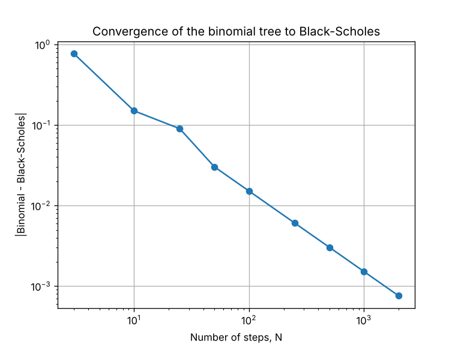
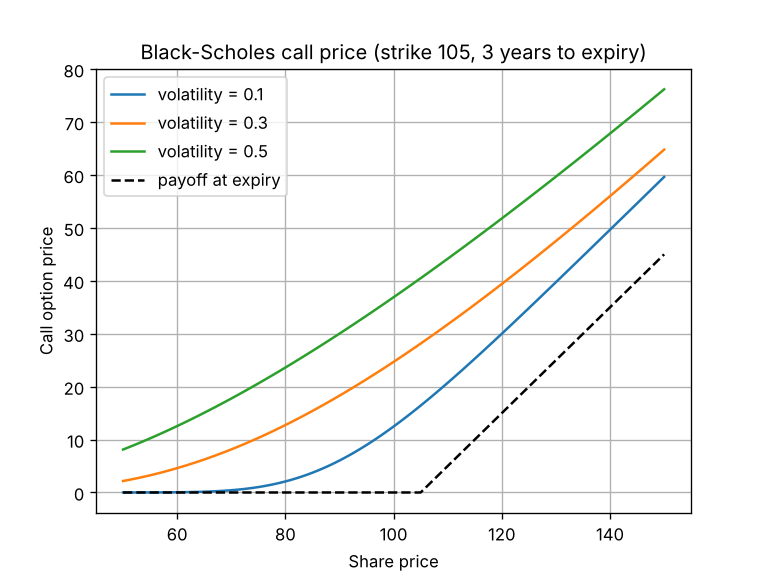

# Black-Scholes and binomial tree option pricer (Python)

A project I did after my degree using ideas from my Mathematical Finance module to get better at Python, since I'd mostly used MATLAB at university. It prices a European call option in two ways and checks that they agree.

- `pricing/black_scholes.py` uses the Black-Scholes formula. The put price comes from put-call parity.
- `pricing/binomial_method.py` uses an N-step binomial tree. The share price goes up or down at each step, the option's value is worked out at the end of the tree, and then it's worked backwards to get the price today.

The Black-Scholes formula only works for simple options like this one, but a binomial tree can be used for more complicated ones. So I tested the tree against the formula, where the right answer is known, to check it works.

## How to run

```
pip install -r requirements.txt
python convergence_plot.py
python main.py
```

`convergence_plot.py` asks for the share price, strike price, interest rate, volatility and time to expiry. It prints the Black-Scholes price, then the binomial price and its error for different numbers of steps N, and plots the error against N.

`main.py` plots the Black-Scholes call price against the share price for three different volatilities.

## Results

The binomial price gets closer to the Black-Scholes price as N goes up. For a share price of 100, strike price of 100, interest rate of 5%, volatility of 20% and one year to expiry, Black-Scholes gives 10.4506 and the binomial tree gives:

| Steps (N) | Binomial price | Error |
|---|---|---|
| 10 | 10.3006 | 0.150 |
| 100 | 10.4354 | 0.015 |
| 1000 | 10.4491 | 0.0015 |

Each time N goes up by a factor of 10, the error goes down by about a factor of 10. The binomial price doesn't get closer smoothly: it goes either side of the answer (at 25 steps it's slightly too high), but by less each time.



Higher volatility makes the call worth more, because there's more chance the share ends up well above the strike price, while the most you can lose is what you paid for the option. All the curves sit above the payoff line because there's still time left for the share price to change.




